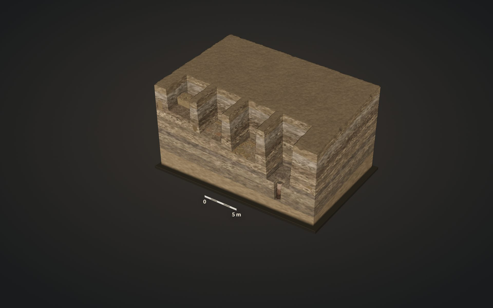

# Purana Qila, in layers



A 3D cut through the ground under Purana Qila in Delhi, oldest layer at the bottom. Drag the timeline from Pre-Mauryan (540 BCE) up to Mughal. Click a dot to see what the ASI found there, and where it's written up.

Live: https://avinxshkd.github.io/purana-qila-in-layers/ (there's a 60 s film under "Watch the film")

It's a composite, not one real trench. Features come from the ASI seasons of 2013–14, 2017–18 and 2022–23. Thicknesses and positions are schematic, and dates follow Table 1 of Swarnkar & Bal. They still haven't hit natural soil.

Sources:
- Swarnkar & Bal, Heritage 11.1 (2023–24), pp. 351–370: https://web.archive.org/web/20251207003923id_/https://www.heritageuniversityofkerala.com/JournalPDF/Volume11.1/15.pdf
- PIB, 30 May 2023: https://www.pib.gov.in/PressReleseDetailm.aspx?PRID=1928410
- Indian Express, 1 June 2024: https://indianexpress.com/article/long-reads/indraprastha-can-excavations-at-purana-qila-find-its-mahabharata-link-9364812/

```
npm install
npm run dev          # then open site.html
npm run build:site   # output in dist/
```

Built with three.js, three-mesh-bvh and Vite. Fonts are Source Serif 4, Source Sans 3 and Inter. The score is generated in code; no stock audio or images. See THIRD-PARTY-NOTICES.md.

Code is MIT. Everything in public/ except the fonts is CC BY 4.0: credit "Avinash, Purana Qila, in layers". The fonts are OFL. Dev notes are in docs/DEVELOPMENT.md.
